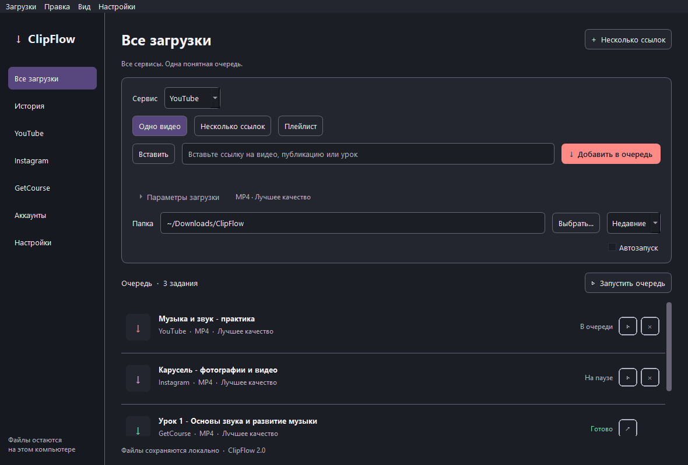
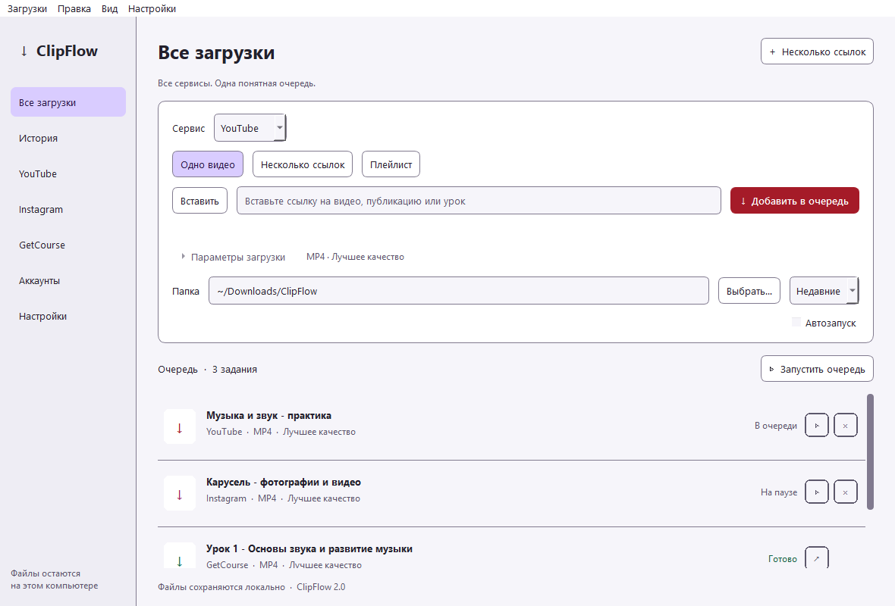

# ClipFlow 2.0

Видео, аудио и фотографии сохраняются в выбранную локальную папку. Единое приложение на Qt Widgets для Windows и macOS; Windows T16 проверяется отдельно, **Mac-приёмка пока не завершена — [T16a](docs/MAC-T16A.md)**.

| Сервис | Реализованные режимы |
|---|---|
| YouTube / YouTube Music | Видео/трек, плейлист и выбор элементов; MP4, MKV, WebM, MP3; проверка доступных высот, Best по умолчанию |
| Instagram | Пост/Reel/карусель, фото и видео, фильтр медиа, описание TXT/MD, профиль 10/50/все с отменой |
| GetCourse | Урок/плеер, несколько видео с выбором, полное название урока, доступ аккаунта школы |

Работа с внешними площадками зависит от доступности материала, региона, ограничений сервиса и аккаунта. Live-приёмка закрытого контента и профилей Instagram остаётся experimental до подтверждения на реальном разрешённом материале. Офлайн-тесты не подтверждают доступ к внешним сайтам.

Очередь, история, пауза/продолжение/отмена/повтор в строке. Одновременно работает **одно задание**. После перезапуска задания восстановлены на паузе; сеть сама не запускается. Автозапуск по умолчанию выключен. Отдельные черновики сервисов, несколько ссылок одним списком, 10 недавних папок; параметры фиксируются при добавлении задания.

Единая светлая/тёмная/системная тема, небольшие акценты сервисов, RU/EN. Историю можно очистить без удаления файлов. Удаление самих файлов требует подтверждения; удаляются только записанные результаты внутри исходной папки.

## Интерфейс

Реальные Qt Widgets captures на Windows с изолированными демонстрационными записями (не HTML-макет и не доказательство сетевой загрузки):




## Установка и запуск

Windows x64: версионный EXE или полностью распакованный portable ZIP. Python, FFmpeg и Node отдельно не нужны. Профиль находится в LocalAppData/ClipFlow; установщик сохраняет его. Mac Apple Silicon/macOS27: текущий DMG — кандидат, нативная приёмка остаётся T16a; ad-hoc подпись, без notarization.

Из исходников после настройки [окружения](docs/DEVELOPMENT.md):

```sh
python run.py
# тот же единственный Qt интерфейс:
python -m clipflow
python scripts/check.py
```

Встроенный вход хранит защищённые сессии (Windows DPAPI / Mac Keychain). Он не гарантирует доступ к любому закрытому материалу. Пароль Google вводится на странице Google, не в полях ClipFlow. Не отправляйте cookies, ключи и профили в Git или отчёты.

[Архитектура](docs/ARCHITECTURE.md) · [Тестирование](docs/TESTING.md) · [Сборка](docs/BUILDING.md) · [Миграция](docs/MIGRATION.md) · [Статус и планы](docs/ROADMAP.md) · [История](docs/CHANGELOG.md)

Разработка в dev; main обновляется после необходимых exact-SHA проверок. Код ClipFlow не имеет открытой лицензии: [COPYRIGHT](COPYRIGHT.md). Лицензии зависимостей сохраняются отдельно.
