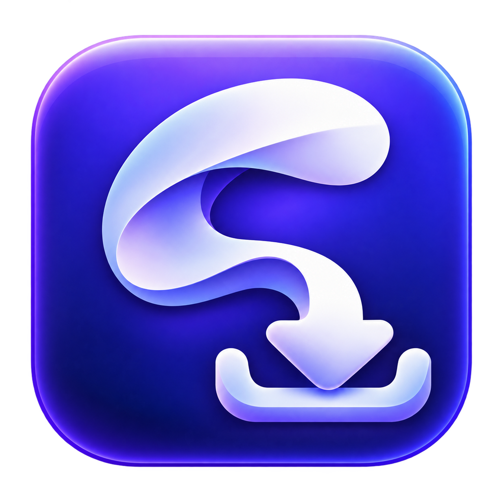
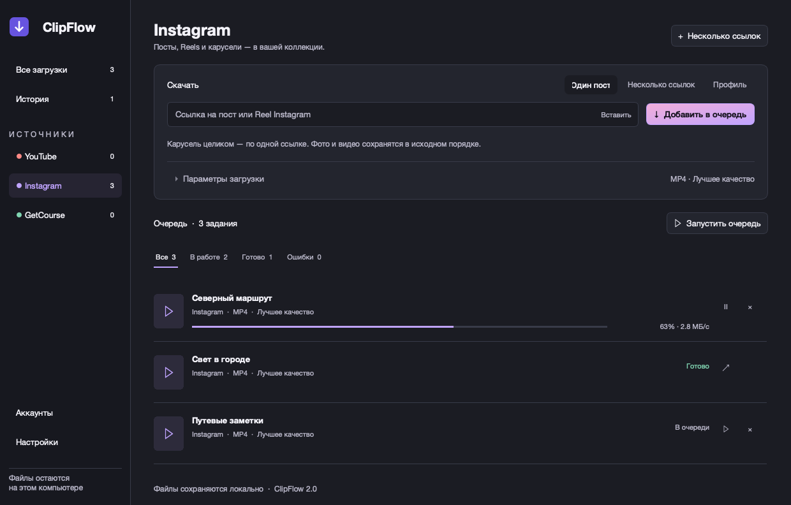
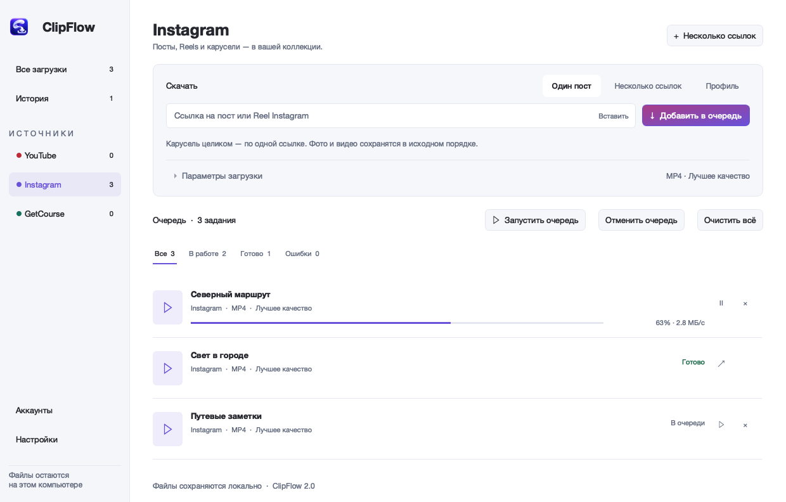
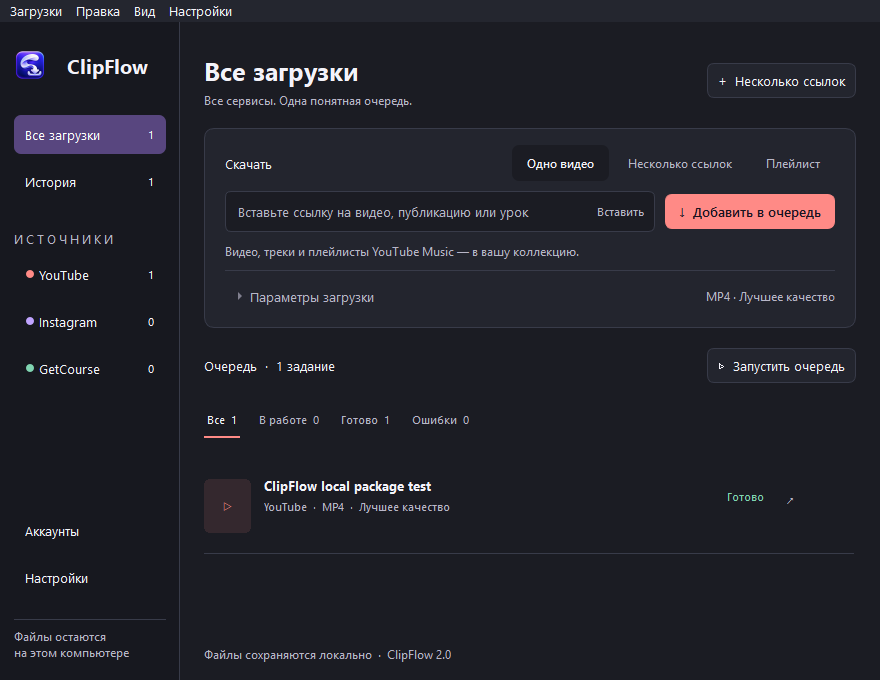
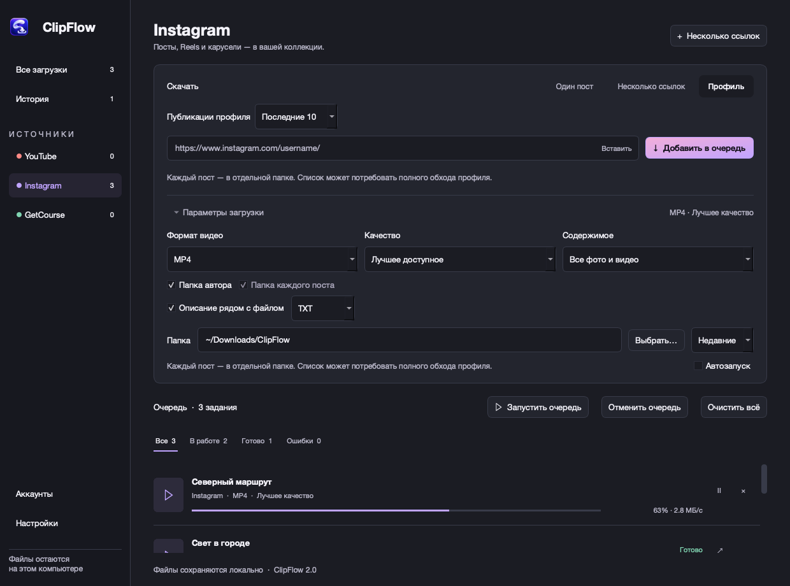

<p align="center">
  
</p>

<h1 align="center">ClipFlow</h1>

<p align="center"><strong>Видео, музыка и фотографии — в вашей коллекции.</strong><br />
Одно приложение для YouTube, Instagram и GetCourse. Windows и macOS. Файлы остаются у вас.</p>

<p align="center">
  <a href="https://github.com/kirillbronski/clipflow/actions/workflows/check.yml"></a>
  
  
  
  
</p>

<p align="center">
  <a href="#интерфейс">Интерфейс</a> ·
  <a href="#что-умеет-clipflow">Возможности</a> ·
  <a href="#установка-и-запуск">Запуск</a> ·
  <a href="#для-разработчиков">Разработка</a> ·
  <a href="docs/ROADMAP.md">Планы</a>
</p>

## Интерфейс

Тёмная тема включена по умолчанию. Светлая и системная доступны в настройках,
как и русский или английский язык. У каждой площадки свой акцент; компоновка
и команды остаются общими.

<picture>
  <source media="(prefers-color-scheme: dark)" srcset="docs/screenshots/qt-macos-dark-design-parity.png" />
  <source media="(prefers-color-scheme: light)" srcset="docs/screenshots/qt-macos-light-design-parity.png" />
  
</picture>

<details>
<summary><strong>Обе темы и Windows</strong></summary>

| Светлая тема · macOS | Тёмная тема · macOS |
| :---: | :---: |
|  |  |





</details>

Снимки сделаны в настоящем Qt-приложении. Демонстрационные задания показывают
интерфейс; они не являются доказательством загрузки этих материалов с площадок.

## Что умеет ClipFlow

| Площадка | Режимы | Результат |
| --- | --- | --- |
| **YouTube / YouTube Music** | Отдельное видео или трек, плейлист, выбор элементов | MP4, MKV, WebM или MP3; доступные разрешения и исходный порядок плейлиста |
| **Instagram** | Пост, Reel, карусель; несколько ссылок; профиль: 10 / 50 / все доступные публикации¹ | Фото в исходном формате, видео, папки автора/поста, описания TXT или Markdown |
| **GetCourse** | Урок или плеер, выбор материалов из урока | Видео с читаемыми названиями, доступ через учётную запись школы |

¹ Массовое скачивание профилей остаётся экспериментальным: Instagram может
ограничивать запросы, запрашивать вход или отдавать неполный список.
Поддержка режима в интерфейсе не гарантирует доступность каждого профиля.

- **Несколько ссылок одним списком.** Площадка определяется автоматически;
  перед добавлением видны ошибки строк и дубли.
- **Управляемая очередь.** Прогресс, пауза, продолжение, отмена и повтор.
- **Плейлист одной строкой.** Плейлист YouTube и профиль Instagram занимают в очереди одну
  строку со сводкой (сколько треков, сколько скачано, ошибки, размер). «❯» открывает экран
  с треками; меню «⋮» приостанавливает, продолжает, повторяет неудачные, открывает папку,
  убирает или удаляет файлы всего плейлиста.
  Одновременно выполняется одно задание; «Скачивать сразу» по умолчанию выключено.
  Если загрузка не удалась, строка задания называет причину простыми словами,
  а подсказка показывает её код.
- **Параметры сохраняются отдельно для площадок.** У задания свой снимок
  настроек — последующие изменения формы не меняют уже добавленную загрузку.
- **Вся очередь одним действием.** «Скачать всё» запускает очередь, «Остановить всё»
  останавливает текущие и ожидающие задания. «Очистить…» убирает список всех площадок и историю;
  в подтверждении можно отдельно включить удаление скачанных файлов с диска.
  Галочка удаления по умолчанию выключена. Обе команды быстры и на длинной очереди:
  плейлист из 700 треков останавливается и очищается примерно за 0,6 с, 2000 заданий — меньше 2 с.
- **История и файлы.** Открытие папки, повторная загрузка и очистка записей.
  Физическое удаление файлов требует отдельного подтверждения.
- **Восстановление после перезапуска.** Незавершённые задания возвращаются
  на паузе, без самопроизвольного запуска сети.
- **Привычный ввод.** Кнопка вставки, контекстное меню и Ctrl+V / Command+V;
  системные сочетания редактирования и русская раскладка.

Преобразование в другой контейнер или MP3 не повышает качество исходного
материала. Фото не перекодируются в видео. Прямого скачивания аудио Spotify нет.

## Как пользоваться

1. Выберите площадку и режим: отдельный материал, несколько ссылок или коллекция.
2. Вставьте ссылку. При необходимости раскройте параметры и выберите папку,
   формат и качество. У Instagram панель расширяется до полной высоты настроек.
3. Нажмите **«Добавить в очередь»**, затем **«Скачать всё»**.
4. Следите за загрузкой и открывайте готовые файлы из очереди или истории.

Ссылка на Instagram-профиль требует явного режима **«Профиль»**. Один пост
не разворачивается в скачивание всего аккаунта. Карусель сохраняет исходные
номера элементов: `01.mp4`, `01.txt`, `02.jpg` и так далее; разные посты
можно разнести по собственным подпапкам.

## Установка и запуск

**Текущая версия 2.0.6 — кандидат на этапе приёмки.** Установщики передаются
отдельно; публичный бинарный релиз в GitHub пока не опубликован. Актуальный
код и документация находятся в ветке **`dev`**.

| Платформа | Поставка | Что требуется |
| --- | --- | --- |
| Windows x64 | EXE-установщик или portable ZIP | Запускать установщик либо полностью распаковать ZIP |
| macOS 27+, Apple Silicon | DMG или APP ZIP | Перенести ClipFlow в «Программы» |

В готовые сборки входят Python runtime, FFmpeg, FFprobe, Node.js и необходимые
компоненты Qt WebEngine. Ставить их отдельно для установщика не нужно.
Mac-кандидат имеет локальную ad-hoc подпись; notarization пока не выполнена.
[Отчёт о сборках и проверках](docs/releases/2.0.6-candidate-2026-10-31.md).

### Запуск из исходников

Нужны **Python 3.12**, FFmpeg, FFprobe и Node.js в `PATH`.
Подробная настройка: [DEVELOPMENT.md](docs/DEVELOPMENT.md).

```sh
git clone --branch dev https://github.com/kirillbronski/clipflow.git
cd clipflow
```

**macOS**

```sh
python3.12 -m venv .venv
.venv/bin/python -m pip install -r requirements-dev.txt
.venv/bin/python run.py
```

**Windows · PowerShell**

```powershell
py -3.12 -m venv .venv
.\.venv\Scripts\python.exe -m pip install -r requirements-dev.txt
.\.venv\Scripts\python.exe run.py
```

`python -m clipflow` запускает тот же единственный Qt-интерфейс.
Сборка установщика выполняется на целевой ОС: `python scripts/build.py`.
Windows-сборку на Mac можно собрать в Windows через Parallels.

## Данные и доступ

Файлы сохраняются в выбранную локальную папку. Настройки и очередь находятся
в `%LOCALAPPDATA%\ClipFlow` на Windows и `~/Library/Application Support/ClipFlow`
на Mac. Очистка списка загрузок не удаляет скачанные файлы.

Встроенный вход открывает страницу площадки в отдельном процессе Qt WebEngine.
Защищённые снимки сессий используют Windows DPAPI или macOS Keychain.
После обновления macOS может запросить доступ к ключу профиля; этот запрос
подтверждается в системном диалоге. Пароль
Google вводится на странице Google. Сессии, ключи и cookie-файлы не входят
в репозиторий или комплект передачи проекта.

Доступность материалов зависит от площадки, региона и учётной записи.
Закрытые материалы требуют соответствующего доступа. Instagram использует
общий бюджет запросов и сохраняемый cooldown; HTTP 429 не превращается
в успешную загрузку. [Политика ограничений](docs/INSTAGRAM-RATE-LIMITS.md).

## Для разработчиков

Одна кодовая база для обеих платформ. Интерфейс, команды приложения,
провайдеры и системные адаптеры разделены:

```text
src/clipflow/
├── ui/              Qt Widgets, темы, переводы, формы и model/view очередь
├── application/     Добавление заданий, планировщик, отмена и rate policy
├── domain/          Неизменяемые запросы, состояния, события и правила путей
├── providers/       YouTube/Music, Instagram и GetCourse, общий медиаконвейер
└── infrastructure/  SQLite, настройки, потоки, авторизация и адаптеры ОС
```

Зависимости слоёв однонаправленные: домен ни от чего не зависит, приложение —
только от домена, интерфейс — без инфраструктуры и провайдеров. Таблицу
разрешённых импортов проверяет `tests/unit/test_layers.py`
([архитектура](docs/ARCHITECTURE.md)).

Провайдеры работают вне GUI-потока. События содержат идентификатор попытки:
запоздалый callback старой загрузки не меняет состояние новой. Следующее
задание стартует после подтверждённого завершения предыдущего worker.

```sh
python scripts/check.py
```

Скрипт сначала проверяет стиль (`ruff format --check`, `ruff check`), затем
запускает unit, integration и GUI-тесты в `QT_QPA_PLATFORM=offscreen`, как CI.
Пороги покрытия: **95% строк / 90% ветвей** для ядра и **90% строк** для всего
собственного runtime. Замер включает дочерние процессы, которые запускают тесты
(запуск окна входа, самопроверка сборки); само окно входа WebEngine проверяется
только нативным шагом и в процент не входит. Native clipboard, DPI, защищённый вход и готовые
пакеты проверяются отдельно ([TESTING.md](docs/TESTING.md)): offscreen-тесты
не заменяют запуск настоящего приложения.

Работа идёт в `dev`. `main` обновляется после проверок обеих ОС для точного
коммита и соответствующей нативной приёмки. `.git`, `.venv` и личные сессии
между компьютерами через Google Drive не копируются.

## Документация

[Архитектура](docs/ARCHITECTURE.md) ·
[Разработка](docs/DEVELOPMENT.md) ·
[Тестирование](docs/TESTING.md) ·
[Сборка](docs/BUILDING.md) ·
[Перенос данных](docs/MIGRATION.md) ·
[История изменений](docs/CHANGELOG.md) ·
[Планы](docs/ROADMAP.md)

Собственный код ClipFlow распространяется без открытой лицензии:
[COPYRIGHT.md](COPYRIGHT.md). У компонентов поставки сохраняются их
[сторонние лицензии](THIRD-PARTY-NOTICES.md).
